# FMphoto（HarmonyOS）

面向鸿蒙设备的飞牛 NAS 相册客户端。交互贴近系统图库，预览支持 HDR 与实况照片。

> 如果这个项目对你有用，欢迎点亮 **Star**。

飞牛官方鸿蒙 App 已开放内测申请：[社区帖](https://club.fnnas.com/forum.php?mod=viewthread&tid=67389&extra=page%3D1)。本项目为**非官方**客户端。

## 功能

> 相册与登录请求发往你自己的 NAS，或你选择的飞牛官方中继。配置可同步到华为云空间或你填写的 WebDAV，反馈提交到飞书表单。这些传输不经过开发者的服务器。

- **登录**：FN ID 或直连地址（HTTP / HTTPS），支持双重验证与会话保持；口令优先用 HUKS 加密存放，也可直接打开飞牛网页。
- **时间线**：日 / 月 / 年三档粒度，双指捏合切换；长按进入多选，支持连续划选。
- **HDR 与实况**：原图按 HDR 解码，画面角上标出 HDR Vivid；安卓 / 鸿蒙 / iOS 的实况照片都能播放，也能存成系统动态照片。网格缩略图走 SDR 解码，控制大图库的内存占用。
- **一镜到底的预览**：从宫格点开时位置与大小连续过渡；未放大时上滑看详情、下滑退出；视频按需预取，拖动进度不会重复下载缓存。
- **搜索与智能相册**：AI 搜索、智能分类、人物相册、照片足迹地图（均需 NAS 侧开通）。
- **连接与选路**：内网、公网、飞牛官方中继三路并行探测；中继只在前两者都不可达时兜底，登录后可在「我的」中手动切换。
- **满载模式**：内网自动满载；公网与中继默认限制利用率，可临时开启，进程退出即恢复自动判定。
- **本机同步**：把手机相册备份到 NAS。公开发布包走系统选图（单次最多 500 张）；自行申请相册读取权限并签名后，可全自动扫描上传。开启「同步创建相册」后，按本机相册名（相机 / 微信 / 截图…）在 NAS 上创建或复用同名相册，并把同步的照片归档进去。
- **备份去重**：对齐飞牛官方指纹（文件名 + 大小 + 修改时间，±2 秒容差），本机账本与 NAS 全库索引双重比对；实况按同名判定，避免重复上传。
- **文件与传输**：上传、下载、收藏、删除与回收站、批量操作、幻灯片；传输队列可见每条任务进度，后台走 DATA_TRANSFER 长时任务。
- **重复照片**：扫描完全重复与相似照片，可单组合并或全部合并，非保留项移入回收站。
- **配置与外观**：二维码、WebDAV 或华为云空间带走登录与偏好；七套预设配色，也可自定义底色与强调色。

## 介绍图

| 按日浏览 | 月视图 | 年视图 |
| --- | --- | --- |
| 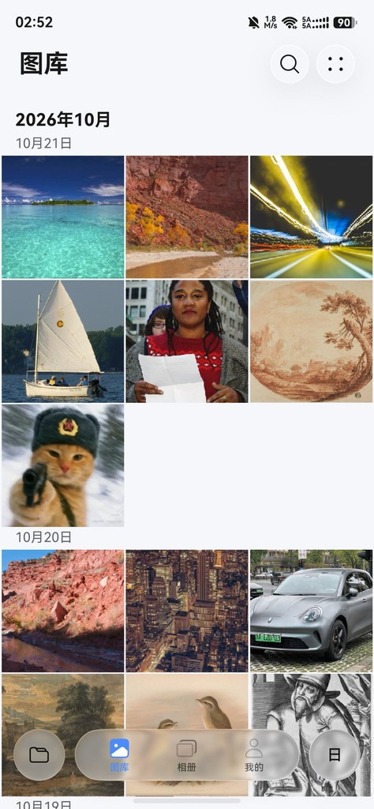 | 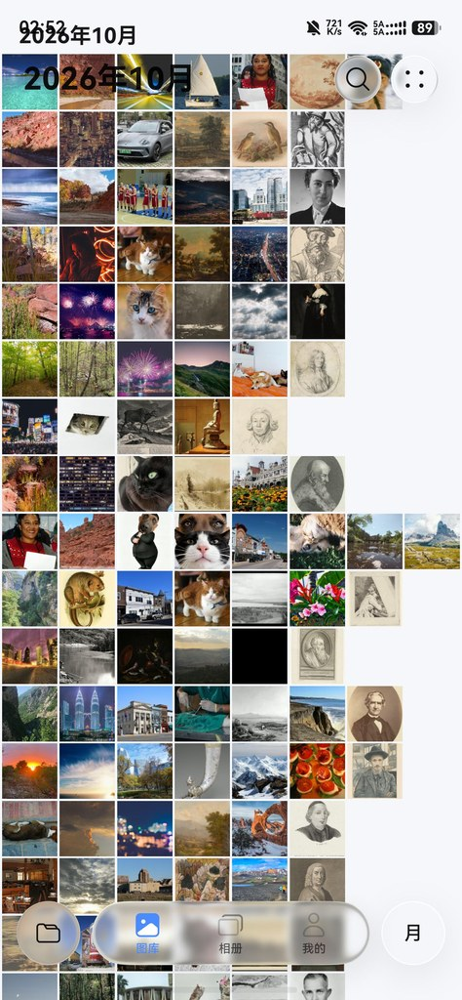 | 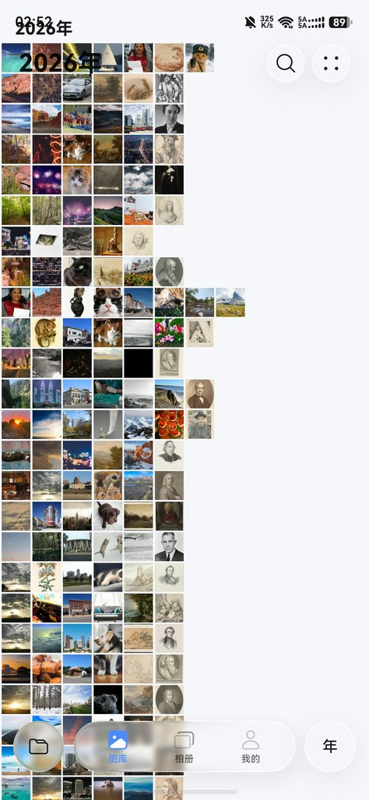 |
| 大图预览（HDR） | 相册首页 | 相册入口 |
| 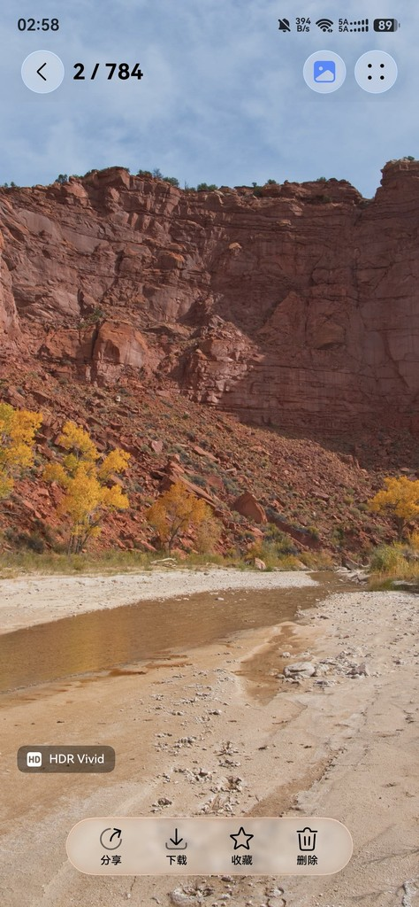 | 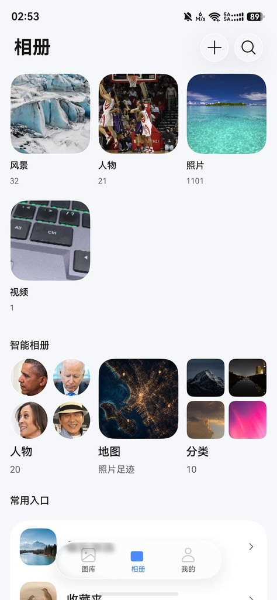 | 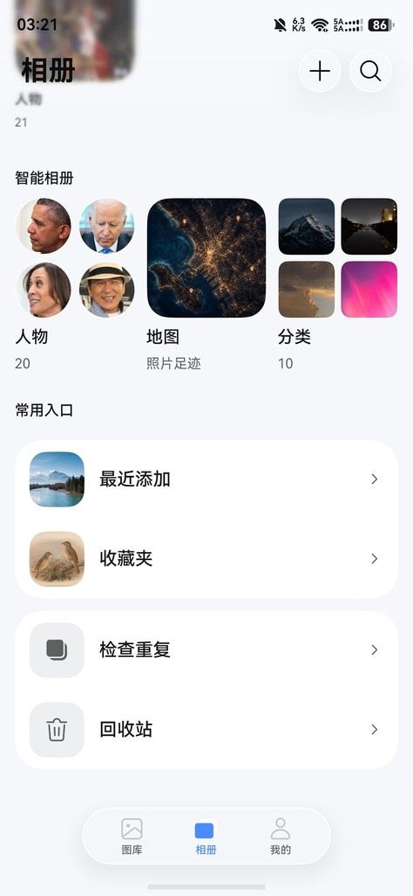 |
| 人物相册 | 智能分类 | 收藏夹 |
|  | 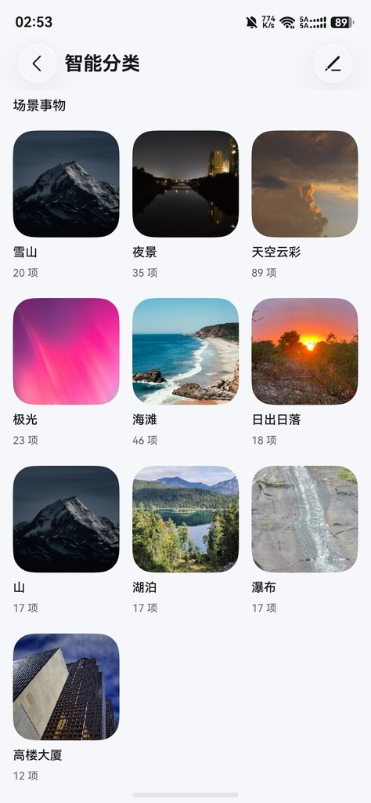 |  |
| 文件夹浏览 | 相册目录 | 图片列表 |
| 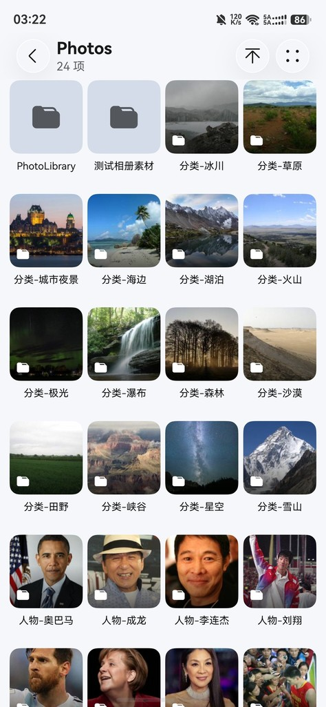 | 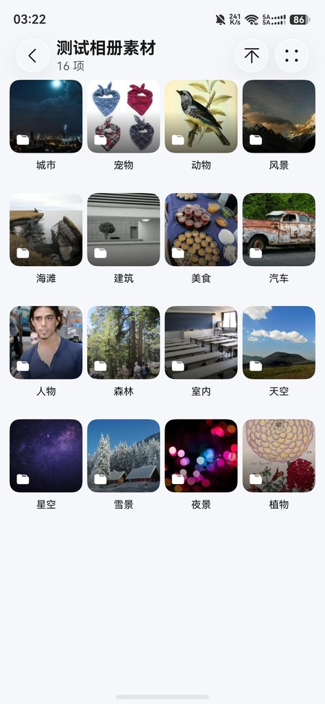 | 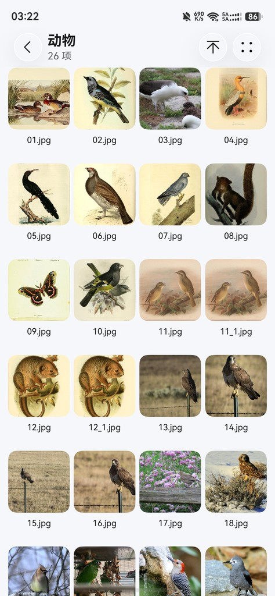 |
| 幻灯片 | 照片详情 | 任务队列 |
| 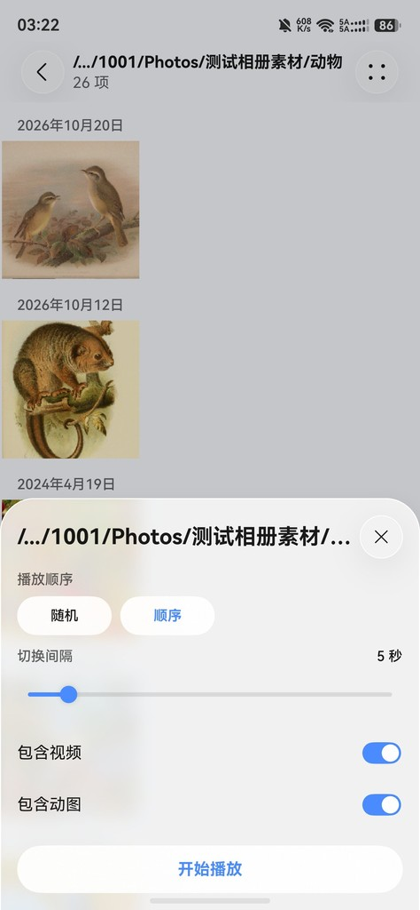 | 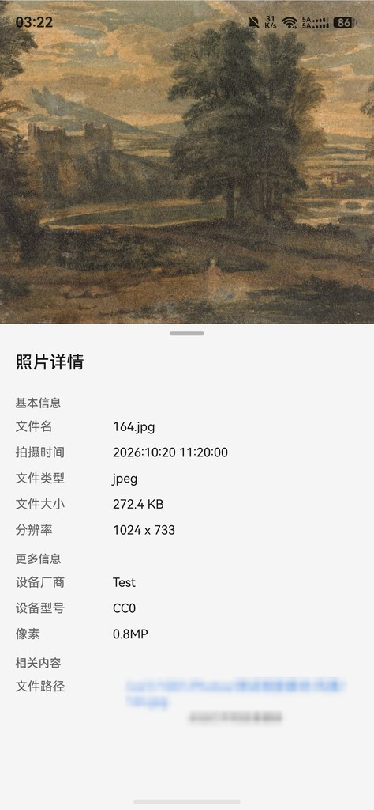 | 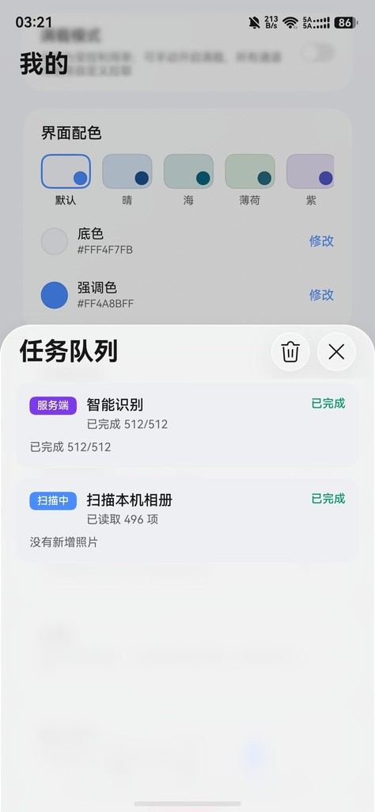 |
| 备份设置 | 配置同步 | 我的 |
| 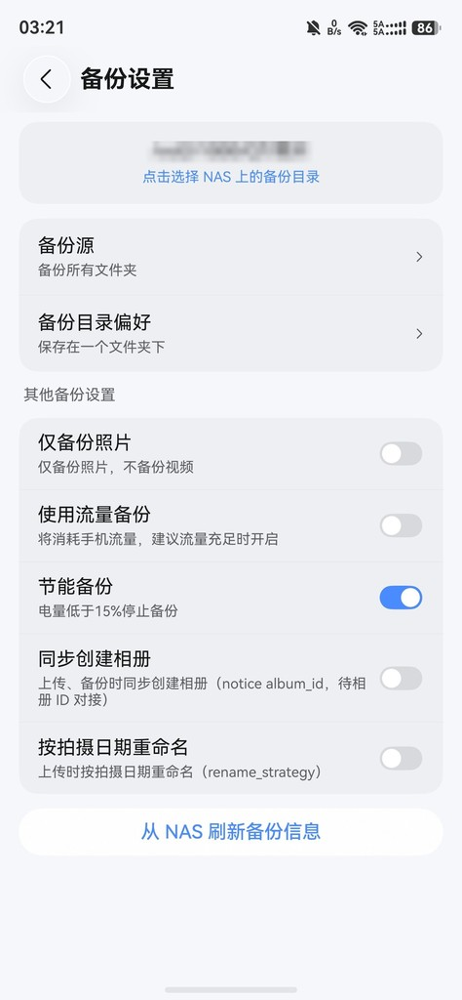 | 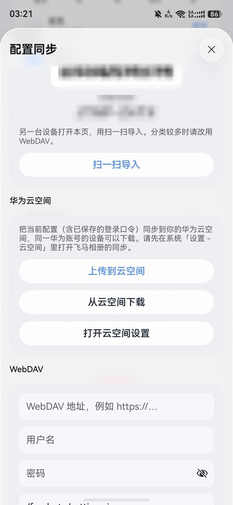 | 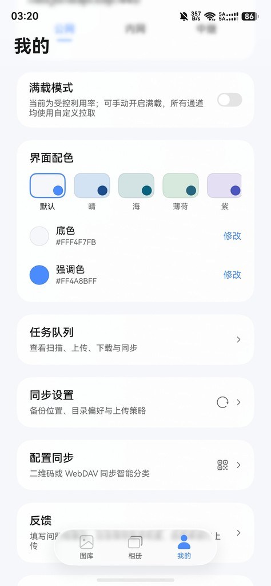 |

## 下载与安装

**请从华为应用市场安装最新正式版。** 本仓库为开源快照，功能与版本可能落后于商店。

| 渠道 | 说明 | 入口 |
| --- | --- | --- |
| **华为应用市场（推荐）** | 已上架，普通用户请走这里 | [打开应用详情](https://appgallery.huawei.com/app/detail?id=com.jonas.fmphoto&channelId=SHARE&source=appshare) |
| GitHub Release | 历史未签名 HAP，仅供自行签名侧载 | [Releases](https://github.com/jonas-pi/FMphoto/releases) |

手机上也可打开「应用市场」，搜索 **FMphoto**。安装后填写 NAS 地址与账号即可使用。部分入口无数据时，请先在 NAS 确认相册服务、AI 能力与账户权限已开启。

### 自行侧载（开发者）

GitHub Release 只提供**未签名 HAP**（`entry-default-unsigned.hap`），不能直接点开安装。纯血鸿蒙必须用华为开发者证书签名后才能装到真机；未签名会报「签名文件不存在」（9568320）。官方说明见 [配置调试签名](https://developer.huawei.com/consumer/cn/doc/harmonyos-guides/ide-signing)。

可用 [小白调试助手 Auto-Installer](https://github.com/likuai2010/auto-installer)，或在 [DevEco Studio](https://developer.huawei.com/consumer/cn/deveco-studio/) 里自动签名后 `hdc install`。签名材料（`.p12` / `.p7b` / `.cer`）不要发给他人。

## 许可证

本项目由 **jonaspi** 原创并持有著作权，采用 [PolyForm Noncommercial License 1.0.0](./LICENSE)（[NOTICE](./NOTICE)）。

- **允许**：个人学习、自用、非商业再分发与修改。
- **禁止**：任何商用，包括售卖、收费分发，以及作为商业产品或服务的一部分。
- **署名**：复制、修改或再分发时必须保留原作者 **jonaspi** 及许可证中的 `Required Notice`。
